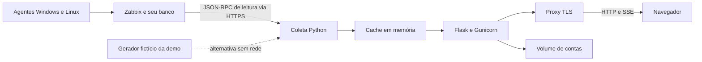

# Arquitetura e critérios de leitura

O Zabbix recebe as métricas dos agentes e guarda o histórico. O backend consulta
essa API e monta a representação usada pelo painel. O navegador fala apenas com
o backend; o token do Zabbix não faz parte de HTML, JavaScript ou payloads.

O banco do Zabbix pertence à instalação do Zabbix. Este repositório não inclui
dump, exportação de hosts ou cópia da stack de servidor. A demonstração funciona
sem esse serviço; para usar dados reais, configure a integração com seu Zabbix.

## Organização do backend

| Módulo | Responsabilidade |
|---|---|
| `zabbix.py` | Métodos permitidos, HTTPS, timeout e erros sem dados internos |
| `demo.py` | Respostas sintéticas no contrato consumido pelos coletores |
| `coleta.py` | Hosts, métricas atuais, problemas e eventos |
| `estado.py` | Thread de coleta, cache, cadências e sinalização dos assinantes |
| `painel.py` | Agregações, contagens e payload da visão geral |
| `capacidade.py` | Faixas de disco e grupos de RAM instalada |
| `detalhe.py` | Consulta sob demanda de uma máquina |
| `series.py` | Agrupamento temporal e descarte de janelas incompletas |
| `rede.py` | Classificação de interfaces e episódios curtos de indisponibilidade |
| `relatorios.py` | Presença do agente por período |
| `contas.py`, `sessao.py` | Persistência local, papéis, hashes, sessões e CSRF |
| `acessos.py`, `abas.py`, `aplicativos.py` | Itens opcionais do ambiente integrado |

`Rede` é uma classe porque mantém cache de gatilhos e a validade desse cache.
As regras sem estado ficam em funções. Essa combinação evita criar classes
apenas para agrupar funções, sem esconder o estado que realmente existe.

## Como um dado chega à tela

1. O laço consulta os dados vencidos: 5 s para problemas/eventos, 30 s para
   inventário, 120 s para séries/rede.
2. O backend agrega o resultado e incrementa a versão do payload.
3. Uma `Condition` acorda quem está esperando um novo estado.
4. `/api/fluxo` envia um evento SSE. Sem alteração, envia um pulso a cada 10 s.
5. Os componentes leem o estado compartilhado do frontend e redesenham suas áreas.

Se o SSE não funcionar, o frontend tem consulta periódica de reserva. No proxy,
`proxy_buffering off` evita que as mensagens fiquem acumuladas antes de chegar
ao navegador. O botão Atualizar solicita uma coleta; recarregar a página apenas
consulta o cache existente.

## O que as métricas significam

**Online:** usa `zabbix[host,active_agent,available]`; se esse item não existir,
usa o último contato de agente e `OFFLINE_APOS`.

**Sem dados recentes:** nenhum item de agente recente dentro de `SEM_DADOS_APOS`.
Itens calculados e internos não atualizam o último contato. Isso impede que uma
memória calculada com valor antigo faça um host parecer vivo.

**Disco:** considera o volume com menor percentual livre. Os GB livres aparecem
para contextualizar o percentual; somar a capacidade do parque esconderia um
único volume quase cheio.

**Ruído:** escopos configurados, inicialmente `notice`, ficam fora dos indicadores
de atenção, mas permanecem identificáveis. Essa política precisa ser revista por
quem conhece os alertas do seu ambiente.

**Offline e problema:** na regra herdada, alertas de hosts offline ficam no detalhe
da máquina e são excluídos dos indicadores principais. Isso faz sentido para
estações que desligam; pode esconder indisponibilidade relevante de servidores.
Não use os cartões como substituto dos alertas do Zabbix ou de um SLO de serviço.

**Presença do agente:** o relatório divide as amostras de `agent.ping` pelo
esperado de uma leitura por minuto. Não mede sucesso de uma aplicação, latência,
experiência do usuário ou cumprimento de SLA. Intervalo diferente exige ajustar
`PONTOS_POR_DIA`. Há limites de consulta e de retenção: uma janela sem histórico
não prova que a máquina ficou indisponível. O relatório atual apresenta zero
quando não encontra amostras de um item existente; não distingue retenção
insuficiente de ausência real. Hosts sem `agent.ping` ficam fora da lista.

**Rede:** conta episódios que se resolvem em até 15 minutos. Não mede perda de
pacotes. A classificação por nome da interface é heurística.

## Limites arquiteturais

Uma única instância é suportada. As contas ficam em JSON com escrita atômica e
trava entre processos, adequado a uma equipe pequena. Não há banco distribuído,
fila, alta disponibilidade nem cache compartilhado.

Os projetos e a classificação local/nuvem usam convenções de hostname. Isso
reduz cadastro, mas nomes inconsistentes produzem classificação incorreta.
A configuração de exemplo usa `PROJETO-A`, `PROJETO-B`, `PROJETO-C`, blocos A/B e prefixo
`CLOUD`; o mapa não usa IP interno fixo para decidir onde um servidor está.

Séries do parque continuam disponíveis no payload embora nem todas tenham
consumidor visual. Essa compatibilidade tem custo de API e é uma oportunidade
de otimização antes de aumentar o parque.
